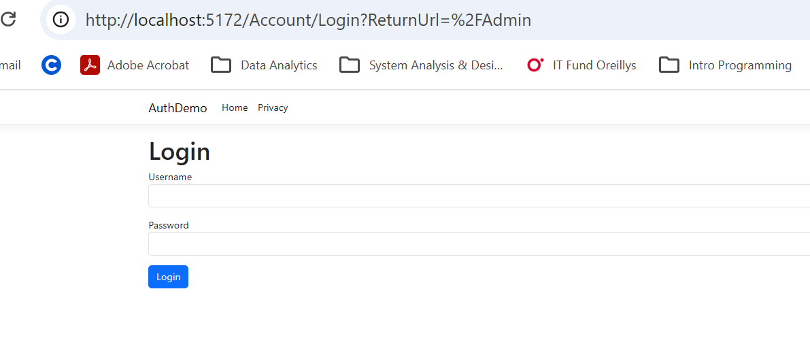
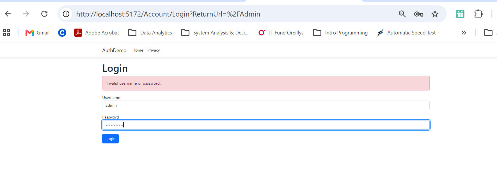
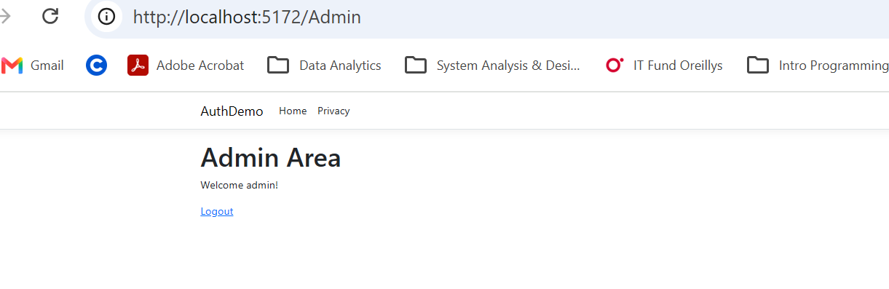

# AuthDemo

## Project Description

This is an ASP.NET Razor Pages application demonstrating authentication/authorization using cookies.

## Login Credentials

Username: `admin`

Password: `Password123`

## How to Run

1. Open the project in Visual Studio.
2. Run the application.
3. Navigate to the Login page (using your localhost).
4. Enter the username and password.
5. After a successful login, the admin page is shown.
6. Use the Logout link to sign out.

## Screenshots

### Login Form

### Invalid Login

### Admin Page

